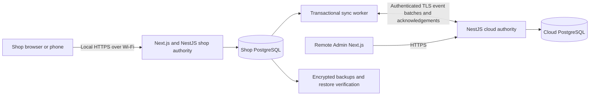

# Architecture and API boundaries

## Current completion directive (6–7 November 2026)

CONFIRMED: sequential implementation of remaining V1 workflows is now authorized in isolated development/test environments. Older phase-stop text below is historical. Preserve UUID/SKU/Product/Lot and DYI:1 identities. Physical units use permanent six-character codes and DYI:2; checkout and lifecycle operations require append-only domain/ledger evidence. All three existing roles may confirm checkout. Missing reasons create reconciliation obligations; Order IDs are optional and reusable. A maximum of 10,000 units/100 receipt lines is approved subject to benchmark proof. General catalogue administration remains Admin-only, with Manager product registration restricted to receiving. Operational migrations, historical enrollment, real invitations/live stock and deployment remain separately gated. Dedicated shop-server/LAN deployment and synchronization transport: **Deferred — awaiting owner direction**. See dayari-completion-progress.md for actual implementation status.

## Owner correction — six-character unit identities and inventory UX

Slices1–3 authorize compact role-aware navigation, inventory-sheet/drawer and stock-focused overview only. Existing service/ledger/QR/print/account mutation authority is unchanged. Future StockUnit human codes are exactly six random readable characters without a fixed U prefix, origin-scoped unique and immutable; UUID remains primary and DYI:2 encodes UUID. Earlier U+7 is superseded. See [six-character-unit-code-design.md](six-character-unit-code-design.md) for database/contract/search/label/collision rules. No unit implementation/cutover is authorized. Secure staff email invitations are approved future direction only; [staff-invitation-design.md](staff-invitation-design.md) describes separately gated trust and delivery boundaries. Current password policy remains unchanged.


## Phase B — shop account boundary

The owner approved SHOP-local staff administration, supervised initial passwords with compulsory change, and explicit isolated membership. User UUIDs remain global historical actors, but one immutable ShopMembership assigns an account to one origin. Sessions carry that origin and require matching active membership. Existing accounts/sessions are preserved without implicit enrollment; null-origin historical sessions fail authentication. New migrations009/010 are isolated-test only until separate operational authorization.

AccountsService adds bounded Admin directory/detail and idempotent create/update/revoke commands, plus own profile/password change. Existing same-origin Next proxy uses explicit route allowlists and HttpOnly Strict cookies. Capability allowlists are shared in contracts; service guards still enforce active roles. Compulsory-change sessions can only read minimal me/change password/logout. User authentication generation changes fence stale in-flight writes under origin-first locks; password/role/status changes revoke all sessions. Persisted login/proof failure limits use PostgreSQL advisory locks. No credential/proof in audit/outbox/command responses; no reset delivery, account deletion, public registration, cloud user writes or sync authority is introduced.

Phase B operational UI reuses the existing stock/receipt/label read contracts for Admin/Manager reports. AvailabilityService adds bounded positive-U-only identity discovery with repeatable-read pagination and strict current-origin filtering, without reading damage/invoice/audit/printing rows. It is not the future universal fuzzy search/hierarchy. Native account/label draft guards preserve unfinished edits on canceled navigation; ordinary printing retains the original PDF renderer and immutable evidence. API process startup validates the required account columns and stops with a clear upgrade gate when missing; it never migrates or enrolls accounts automatically.

## Phase1 public identity boundary

Two immutable typed sidecars add origin-qualified alternate keys without changing UUID/SKU/lot authority. Backend allocation shares existing catalogue/receiving command transactions; deferred INSERT guards reject new unmapped products/lots. PublicIdentitiesService provides authenticated exact typed reads with role DTOs, no fuzzy search or stock writes. Minimal existing-workspace code form; old PDF/QR infrastructure unchanged. Backfill engine/CLI is isolated *_test-only, dry-run/saved-plan/replay with separate audited metadata. Operational migration/deployment is not performed. See phase-1-implementation-report.md.


Brick 0 review draft, 2 November 2026. CONFIRMED source requirements are cited to the root PRD. Everything under proposed design is PROPOSED engineering, not an approved business rule. Approval gates are in `decisions.md`.

Implementation addendum: the user subsequently authorized the first catalogue slice and approved local single-writer authority, UUID/value-combination identity, Admin-only creation, Manager access to existing entries and manual SKU allocation. `brick-1-report.md` records the implemented subset. The NestJS API uses the supported Fastify adapter to avoid importing an unused file-upload dependency. Local authenticated catalogue only is implemented; cloud sync and all stock workflows below remain the architecture plan. Webpack mode is selected for reliable Next.js development/builds on this Windows host. No production hardware or deployment approval is inferred.

## Confirmed constraints

PRD §7 requires an always-on shop server and PostgreSQL reachable over shop Wi-Fi, local operation during internet failure, a secure cloud Admin API/dashboard, bidirectional event/master-data sync, shop authority for operational events and explicit cloud freshness. Ordinary receiving, issuing, damage, reconciliation, completion and closing cannot require cloud availability. Remote approval is unavailable locally until delivered. Cached permitted users can work offline; cloud deactivation takes effect after sync and stale-auth periods are logged. Local Wi-Fi/server failure is outside the promised internet-outage boundary. §10 requires secure passwords, HTTPS, durable storage and encrypted backups. The approved stack is fixed by AGENTS.md/user; modular-monolith preference is confirmed engineering direction.

## Proposed deployment



PROPOSED: TypeScript monorepo with `apps/web`, `apps/api`, `packages/contracts` (Zod API/sync schemas), and `packages/db` (Prisma plus reviewed SQL migrations). NestJS modules: identity/access, catalogue/sourcing, receipts/labels, ledger, production, damage/approvals, reconciliation, closing/counts, reporting and sync/audit. Modules call services, not one another's table internals. Ledger is the only operational stock writer. UI never calculates authoritative stock or authorizes actions. Tailwind/shadcn components expose only approved task fields. No app files are created in Brick 0.

PROPOSED: same versioned API/schema code at shop and cloud with explicit capability configuration. Cloud reads replicated balances and owns remote Admin decision commands; it does not issue against stale stock. Shop accepts commands, validates current state and produces authoritative stock events. Cloud reports approval states separately as requested, decided, delivered, applied or rejected-at-shop; “approved” alone must not imply stock changed. Admin actions taken locally use the same permission/approval checks if O5 permits local Admin authentication. No multi-master balance merging, no last-write-wins quantity updates.

PROPOSED: responsive browser app with optional PWA shell; disconnected phones must reconnect to shop to commit stock. Do not queue independent phone stock mutations in browser storage. Phone cameras require a trusted local HTTPS origin; certificate provisioning, DNS, operating systems, UPS and printer support await O2/O7. Label output starts with a printable browser layout only if printer compatibility is approved. A print failure never rolls back committed stock or creates a second receipt; it generates a retryable print task with logged attempts.

## Authority boundaries

| Record/action | CONFIRMED rule / PROPOSED enforcement |
| --- | --- |
| Receipt, issue, damage, classification, completion, count, close | CONFIRMED shop authority (§7); PROPOSED reject cloud stock writes at service and DB role boundaries |
| Correction/recovery decision | CONFIRMED Admin-only and no unreceived approval (§2/7); PROPOSED immutable command bound to request version/hash; shop applies once after eligibility check |
| Catalogue and code allocation | OPEN B08/V01/V02/V03; PROPOSED local single writer initially; cloud proposals accepted/rejected by owning shop, never silently merged |
| User roles/activation | CONFIRMED cached permitted users, delayed revocation (§7); PROPOSED cloud-controlled monotonic user versions, local stale-auth audit; provisioning/local Admin details OPEN O5/B09 |
| Cloud read models | CONFIRMED as-of display (§6/7); PROPOSED derived from accepted shop sequence, never authoritative for available stock |
| Physical inventory | CONFIRMED independent counts (§11); PROPOSED count sessions and discrepancies, no balance overwrite |

User authorization and sync service authorization are distinct. Replicated audit retains original actor/role/source rather than treating sync worker as stock actor. Source authentication alone cannot authorize an invalid Admin decision. Restoring a node never automatically creates a second active shop authority.

## Proposed transaction and sync protocol

Every stock command uses `Idempotency-Key` scoped to authority and actor/command type, with canonical request hash. In one local PostgreSQL transaction: reserve/lock key; check authorization and input; lock affected stock/issue/approval rows in stable order; recheck current constraints; persist domain records, balanced ledger, projections, audit, outbox, and stored response. Same key/hash returns stored result; same key/different hash conflicts. New intentional scans need new keys; shared QR content is not an idempotency key. Rollback produces no accepted partial operation. HTTP response loss is resolved by retrying original key.

PROPOSED envelope:

```text
eventId: UUID; originNodeId: UUID; authorityId: UUID
originSequence: monotonically committed stream position
eventType; schemaVersion; aggregateId; aggregateVersion
commandId; correlationId; causationId; actorId; actorRoleAtAction
occurredAt; recordedAt; businessDate; payload; payloadHash
```

IDs are generated locally without cloud allocation. `recordedAt` and committed sequence, not device clock, order acceptance. PROPOSED origin sequence uses a transactionally locked stream counter so a higher sequence cannot be acknowledged before a lower in-flight transaction; ordinary database sequence allocation alone is insufficient for a contiguous commit watermark. Stream counter locking is a throughput tradeoff to measure. Hash canonicalization and protocol serialization are versioned. Distinguish trusted operational audit timestamps from untrusted client-reported times. Business timezone/date rules remain OPEN B05.

Sender retries unacknowledged outbox envelopes with bounded exponential backoff. Receiver authenticates origin, validates version/hash/authority, deduplicates by `(originNodeId,eventId)` and `(originNodeId,originSequence)`, and commits inbox plus replicated domain effects atomically before acknowledgement. Same ID with different payload is quarantined. Gaps/dependencies wait in a durable queue; don't skip to a misleading complete watermark. Replicate a multi-line command as one atomic envelope or explicitly staged complete transaction group, not individually visible half-receipts. Forwarded events retain original identity and are not re-originated into echo loops.

Ack means durable acceptance, not network delivery. Lost ack causes harmless replay. Cloud views use highest contiguous accepted shop watermark and its recorded timestamp; show cloud receipt timestamp and shop last-contact separately so “last sync” cannot imply all pending data is current. Failed/blocked events, pending count, oldest pending age and last success are visible to authorized staff. Node heartbeats do not advance the inventory as-of watermark.

Master data dependencies precede movements, or arrive in the same atomic transaction group. Identity records are retained when inactive. A supported additive event/schema version is negotiated; unsupported versions pause that stream, alert and preserve payload for operator recovery. Never drop or edit a poison ledger event to advance sync. An explicit reviewed repair may correct transport/projection data while immutable business history stays intact.

## Proposed API surface

Version prefix `/v1`. Routes below are boundaries, not implemented contracts. Mutations use authentication, server permissions, Zod validation, idempotency, atomic transaction and audit. Every stock-changing route also locks and writes ledger/outbox atomically. GET scope includes row and field filters server-side. No generic movement CRUD, balance setter, delete-history route or unauthenticated QR stock mutation.

| Module / route sketch | Command or query / authority |
| --- | --- |
| `POST /sessions`, `DELETE /sessions/current`; `GET /me` | Local verified sessions; permitted-user cache policy OPEN; rate-limit login, secure cookies and CSRF protection |
| `GET/POST /suppliers`, `/supplier-sources`, `/products`, `/products/:id/variants`, `/sku-allocations` | Approved catalogue roles only; identity-defining changes supersede; registry allocation policy OPEN |
| `POST /receipts` | Manager/Admin where authorized; one reviewed multi-line receipt, source/batch consistency, all-or-nothing stock receipt |
| `GET /receipts/:id`, `POST /label-print-jobs`, `POST /label-print-jobs/:id/reprints` | Scoped reads/authorized prints; quantity and template audit, zero stock effect |
| `GET /labels/resolve?token=...` | Authenticate, validate QR version, return exact SKU/batch and permitted fields; authorized manual lookup has separate audited path |
| `POST /production/issues` | Production; reviewed exact SKU/batch lines, manual reference or unlinked; PROPOSED atomic issue group, PRD requires distinct immutable line movements |
| `GET /production/issues/eligible-for-damage` | Scope approved in O6; prior issue selection, remaining eligible quantities |
| `POST /damage-reports` | Production against issue; Manager intake path pending O3; issue availability locked |
| `POST /damage/:id/dispositions` | Manager; approved lifecycle only; some outcomes transfer state |
| `POST /recovery-requests`, `POST /correction-requests` | Manager; exact quantities, source IDs, reason; no stock effect until applied approval |
| `POST /approval-requests/:id/decisions` | Admin; immutable approve/reject; cloud decision pending delivery; separate apply result, no self-approval |
| `POST /issues/:id/reconciliations`, `/reference-corrections` | Manager classification; quantity change routed to approval; reference reassignment permission OPEN |
| `POST /production-references/:id/completions` | Manager; attestation scope and any in-production state transfer await B03/O8 |
| `POST /counts`, `POST /counts/:id/observations` | Manager/approved role; observation/discrepancy, no direct stock write |
| `GET /day-closes/readiness`, `POST /day-closes` | Manager; readiness is advisory, close rechecks blockers inside serialized transaction |
| `GET /day-closes/:id`, `/stock`, `/history`, `/trace`, `/sync/health` | Role-limited reads; immutable reports and separately identified post-close links; explicit freshness |
| `POST /sync/envelopes`, `/sync/acknowledgements` | Node/service authentication and origin authority validation; not public user mutation endpoints |

PROPOSED API errors: malformed input 400/422; unauthenticated 401; forbidden 403; idempotency/stock/version/close conflict 409 with stable domain code; unknown/inaccessible resource handled consistently to avoid leakage. Return authoritative command/event IDs, current stock only within permission, approval application status and local data watermark. Replayed success returns original response, not a new stock event.

## Recovery, security and delivery

PROPOSED: Postgres WAL-backed durability; least-privilege app roles; immutable ledger grants/triggers; password hashing with a maintained memory-hard algorithm; encrypted secrets outside repository; TLS node credentials rotated and verified; sanitized audit metadata, no passwords/tokens in logs. Restore backups with inbox/outbox/idempotency/close watermarks together. Backup encryption keys require a recovery custodian and separate storage. Operational target/retention OPEN B09.

Crash before commit: nothing accepted. Crash after commit: replay saved response/outbox. Sync interruption: retry with same IDs. Cloud unavailable: local ordinary work continues, approvals stay pending, show banner. Shop power/server failure: no independent browser writes; restart/restore and reconcile committed data before resume. Disk full: reject new stock commands clearly, preserve committed history, alert. Hardware and recovery targets require approval; no claim of zero data loss from unspecified equipment.

Cloud-first additive upgrades preserve old shop protocol compatibility; destructively incompatible changes require migration plan and outage approval. Rollback application only while schema/protocol remains compatible; otherwise restore coordinated backup and replay safely, never delete accepted ledger history. Development seeds must never be production provisioning. No deployment occurs in Brick 0.


## Implemented ledger and receiving boundary

ReceivingService is a separate domain service alongside CatalogueService, reusing its authentication authority through the API controller. Seven new ledger/receipt tables use UUIDs, SQL FKs, append-only guards and deferred group/projection checks. Receiving retains the origin-first transaction lock, atomically commits audit/outbox/CommandResult, and rejects cloud writes. Browser calls use the existing same-origin authenticated proxy. Admin/Manager task endpoints expose U/D lots and derived SKU/product totals with local as-of time, no valuation/audit access. See receiving-ledger-design.md and receiving-implementation-report.md. Sync outbox remains infrastructure only; no transport, QR or production transitions exist.


## Brick 5B local QR/label boundary

LabelsService adds strict origin/StockLot read-only resolution and task-scoped manual lookup. Production receives minimal identity/usable availability only; label administration stays Admin/Manager. Immutable print manifests/lines/events reuse origin-locked command/audit/outbox transactions without any StockTransaction/Movement/Balance writes. PDFKit/qrcode render locally outside locks; versioned profile and renderer/font hashes preserve reconstruction. Next proxy serves authenticated binary PDFs. ZXing/native camera and focused HID input perform lookup only. No thermal, production deduction or cloud transport. See qr-label-implementation-report.md.


## Admin experience refinement — 3 November 2026

The owner-authorized Admin experience composes existing domain commands into nine client workspaces: overview, catalogue/details, suppliers/sources, inventory/lots, receiving, receipt history, QR lookup, lot-label printing and account/shop. A shared shell, view fragments with optional UUID context, UI state components and cancellable read hook preserve the existing Next.js/same-origin architecture. Fragments are view state, never authorization.

Two additive reads expose existing data: stock/lots/:id provides bounded Admin/Manager receipt/movement provenance under repeatable read and current-origin validation; admin/shop provides minimal configuration to Admin only. Catalogue queries are narrowed to the configured origin, with the shared location registry retained. No mutation, schema, ledger, identity or role expansion. Production stays on minimal lookup/account views. Overview avoids unlike-product quantity totals; exact lot/SKU projections remain authoritative. See admin-experience-implementation-report.md and admin-preservation-evidence.json.

## Invitation vertical slice — 3 November 2026

Additive invitation identities, guarded terminal state, append-only lifecycle/delivery evidence and a private AES-256-GCM delivery queue extend existing shop-scoped account administration. Origin locking, current Admin proof, auth-generation fencing, command idempotency and sanitized audit/outbox commit together. Acceptance creates exactly one staff account and immutable membership with the assigned existing role; it creates no session and is never an account-recovery path. Existing account provisioning stays available.

Only the injected isolated transport exists in this release. No SMTP adapter or real delivery is enabled. Invitation readiness is route-scoped; an unupgraded operational database can continue existing workflows. Query-token acceptance uses no-referrer/no-store, immediate client URL cleanup, suppressed development request logging and explicit same-origin POST proxying. Production proxy log redaction and verified public URL/sender remain rollout gates.

## Local PDF preview and versioned sheet layouts — 4 November 2026

A read-only authenticated preview renders the same local PDF generator used for accepted artifacts. The frontend bundles PDF.js and its worker; page canvases and label crops never regenerate QR artwork. New v2 profiles add gap/bounds and separate purpose-sheet planning. Start positions freeze in immutable ARTIFACT_READY metadata per bounded PDF part. Preparing/handoff reuses existing command/audit/outbox patterns and never touches stock. Historical v1 rendering stays available; accepted manifest timestamps are stable PDF metadata inputs independent of connection-timezone changes. See labels-printing-redesign-report.md.

## SMTP invitation adapter — 4 November 2026
The existing encrypted invitation queue now supports an explicit SMTP adapter alongside isolated tests. STARTTLS/certificate checks, bounded network deadlines and sanitized provider errors apply. Delivery happens outside transactions; payload mode fencing prevents sending isolated messages after cutover. Stable message identity and single-use tokens tolerate uncertain retries. Live readiness fails closed without verified configuration. Local migrations 011/012 applied with owner approval; no production rollout.

## Serialized receiving implementation - 7 November 2026

Milestone 2 adds origin-scoped StockUnit identities, initial immutable UnitEvent evidence, UnitState projections and bounded exact-command manifest pages. LotSerialization classifies historical lots without enrollment. Cutover occurs only when additive migration 014 is installed; operational installation remains unapproved. All native receiving routes use the existing origin lock, actor fencing, idempotency and atomic ledger command. New unit tables supplement, rather than replace or double-count, authoritative lot movements. Paginated receipt-unit reads are Admin/Manager-only. See serialized-receiving-implementation-design.md and the milestone report for database bypass and preservation proof. Unit QR/printing/checkout remain separate milestones.


## Exact-unit QR and label metadata — milestone 3

DYI:2 resolves origin UUID plus immutable StockUnit UUID through an explicit role allowlist. DYI:1 and its retained lot renderers are unchanged. Exact six-character manual lookup uses the configured origin; a short code is never a global database identity. Production receives generic availability and identification only.

Five additive print tables keep exact unit membership, one initial claim per unit, frozen content/profile/renderer, HTML/PDF bytes and hashes, and append-only requested/prepared/handoff evidence. All metadata commands use origin locking, actor fencing, idempotency, audit/outbox and atomic commit. Preparation renders outside the transaction; no print/lookup path changes ledger or unit state. React individual-label previews and local self-contained native-print documents use genuine QR symbols, with a PDF fallback. No browser return implies physical success or attachment. See unit-qr-printing-implementation-design.md.


## Unit tracking and QR presentation metadata — milestone 4

UnitTrackingService provides a role-filtered chronological read model from immutable receiving, exact-unit print and QR-presentation evidence. Production queries only its own QR presentations and the minimal identity DTO; it never queries then hides operational history in the frontend. Origin sequence provides accepted ordering. Delivery date is separate from recording time.

Additive UnitObservation records camera or keyboard/scanner QR presentations under existing origin/actor/idempotency/audit/outbox transactions. Lookup remains read-only; observation acceptance changes no stock/unit-state/print records. The client preserves successful identification if history recording fails and offers explicit same-key retry. A QR presentation is not proof of physical custody, attachment or stock movement. Unit drawers preserve list/receipt context, and typed exact Unit matches do not override Product/Lot namespaces.


## Exact-unit checkout and deferred authorization — milestone 5

CheckoutsService extends the existing modular monolith and origin-first transaction protocol. Separate immutable Checkout/CheckoutLine/CheckoutException records bind exact units to ISSUE movements/events and rebuildable balance/state projections. Migration 021 is additive and test-only until operational approval; it preserves historical receipt/SKU/Product/Lot/QR/print identities. A role-neutral accepted response avoids sensitive-field disclosure on replay after a role change. Production reads only its own checkout/presentation history. Browser drafts are actor/origin scoped and retain the exact pending payload/key after uncertain network results.

Owner O5 explicitly defers cloud-delivered approval execution and infrastructure. Recovery/correction request slices may validate and record pending evidence, but may not execute local approval or stock changes. Independent checkout, BAD, Manager reconciliation/completion, closing and reporting continue. See recovery-correction-request-design.md; no new delivery trust mechanism or cloud transport is introduced.


## Missing-reason reconciliation — milestone 6

ReconciliationService appends immutable ReasonReconciliation and exact CheckoutReasonResolution records. Only a current shop Manager may classify; Admin/Manager read scoped operational evidence. Origin-first locking, current actor fencing, sorted exception locks, canonical idempotency and unique exception ownership prevent duplicate classification. Root, manifest, rows, audit, outbox and command result commit together. No stock transaction, movement, unit event or projection is created or changed.

Original checkout acceptance JSON remains frozen, including replay. Separate live status reads expose outstanding obligations and status-as-of time. Production receives only own checkout status, never Manager remarks or reconciliation administration; operational timelines include the classification. Pre-022 schemas retain existing reads through readiness gating. See reason-reconciliation-implementation-report.md.


## Exact-unit damage and disposition — milestone 7A

DamageService resolves unit/lot/receipt/checkout/holder provenance server-side. Immutable DamageReport/Line bind U-or-P-to-D movements and contiguous unit events to one origin-locked command. Production SQL admits only its own currently issued units; Admin/Manager may report pre-issue or other issued units. Immutable DamageReview/Line distinguish metadata-only Held/Reworked from Manager-authorized D-to-X Discarded/Returned dispositions. No recovery is enabled. Root completeness, exact graph, native census, projection reconciliation and immutable/late-child guards protect all accepted evidence. Existing receiving and checkout remain available on pre-damage schemas, while damage readiness denies activation until an approved installation.

Unit timelines read actual BAD/removal events and metadata reviews; Production receives only its own originally Production-authored BAD evidence, never Manager review notes or other workers' reports. Role reductions cannot replay earlier privileged damage DTOs. Drafts remain actor/origin scoped and retain uncertain payload/key; lookup or scanning never confirms damage automatically. See bad-reporting-implementation-design.md and its report. Pending recovery/correction requests are the next independent sub-slice; cloud authorization execution remains deferred.


## Pending authorization evidence — milestone 7B
AuthorizationRequestsService records Manager-only recovery/correction requests under the existing origin lock, current account fence, deterministic exact-target locks and canonical idempotency protocol. Immutable request roots/children, audit, outbox and command results commit together. Recovery captures exact damaged units and versions; correction independently captures ledger/projection quantities and rejects stale reviewed values. Neither changes stock. Admin/Manager can read scoped pending evidence; Production cannot. Operational unit timelines distinguish pending recovery metadata from stock transitions. Cloud approval delivery and execution remain deferred; no local substitute exists.


## Explicit production completion — milestone 8A
CompletionsService admits current shop Managers only for an explicit exact-unit manifest. Immutable ProductionCompletion/Line tie P-to-C COMPLETE movements and contiguous COMPLETED events to original checkout/holder provenance. Origin-first locking and current account fences preserve atomicity and replay semantics; rebuildable P/C projections reconcile against ledger and native unit census. Other units under reusable Order IDs remain independent. Admin/Manager read scoped work/history; Production receives no completion administration. Additive migration 027 extends existing enabled transition guards without rewriting historical records. See production-completion-implementation-design.md and its actual verification report.
