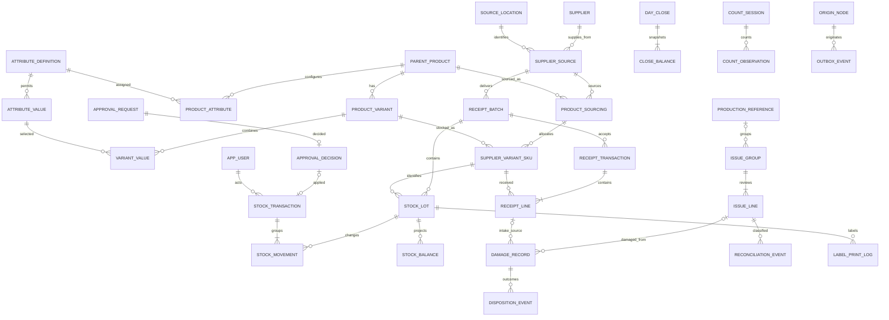

# Proposed database design and ERD

## Future unit-code constraint correction — design only

The owner now requires exactly six random readable alphanumeric Unit Code characters, no fixed U prefix: UNIQUE(originId,unitCode), CHECK against ^[23456789ABCDEFGHJKMNPQRSTUVWXYZ]{6}$, immutable retained mapping and UUID PK. Capacity887,503,681 per origin. StockUnit is not implemented. See six-character-unit-code-design.md for allocator/exhaustion, exact typed lookup and QR compatibility. No schema or migration is changed in Slices1–3.

## Phase1 implemented additive identities

Migrations202611030007_public_identities and202611030008_public_identity_guard_record add ProductPublicIdentity(productId PK/FK) and LotPublicIdentity(lotId PK/FK), origin/code unique, policyVersion, deferred command FK, assignedAt and SQL provenance/immutable/new-subject completeness guards. Historical subjects are not backfilled by DDL. No original ledger row/model is rewritten; no StockUnit table exists. Subject mapping is mandatory only for new inserts after trigger installation. Tests/migrations exercised on isolated dayari_test only; operational schema remains unchanged.

Brick 0 design baseline, 2 November 2026. Table names, columns, constraints and migration ordering below were PROPOSED for review. Required identity and audit semantics derive from PRD §4, §7–8 and §15. At Brick 0 no Prisma schema, SQL migration or database had been created. The subsequent implementation is identified in the addendum. OPEN decisions in `decisions.md` constrain further work.

Implementation addendum: after first-slice authorization, `../prisma/schema.prisma` and migration `202611020001_catalogue_foundation` implement the catalogue/auth/audit/idempotency/origin/outbox/inbox subset. The initial ERD below remains the complete proposed target, not an assertion that stock tables already exist. See `brick-1-report.md` for actual schema coverage and approved deviations. No stock ledger/balance/receipt table is created until the receipt slice.

## Identity model

Use immutable UUID primary keys for every durable entity, including supplier, location, source, product, variant, sourcing relationship, SKU and batch. IDs are generated locally and portable to cloud. Readable codes are unique alternate keys, never parsed to reconstruct relationships. Store approved normalization keys separately from display strings. Do not assume any base-code segment length or meaning. A default variant has the canonical empty attribute set, unique within its parent. Variant identity changes require supersession; display-name edits have audit/version history.

PROPOSED `supplier_source` identifies supplier + stable source location. `product_sourcing` additionally identifies that source + shared parent product and owns its opaque base SKU. `supplier_variant_sku` links sourcing to one variant with suffix/full code. This explicit sourcing entity extends the minimum §15.6 table list to preserve the immutable sourcing identity required by §15.2. Red from two suppliers shares parent/variant but has different sourcing and SKU. OPEN: registry/global code scopes V01/V02, location semantics and receipt supplementation B02.

## Initial ERD

The ERD shows principal relations; authoritative constraint detail below also covers audit, requests, completion and sync. Cardinalities for optional intake/issue damage are an exclusive choice, not permission to omit both sources.

## Proposed tables and constraints

All quantities are integer units with checked safe application bounds; use `BIGINT` in database and explicit contract serialization (not unsafe JS number conversion). All times `timestamptz`; business date stored separately under approved timezone. Each entity has immutable ID, origin/authority and recorded timestamps; mutable master records have version, active status, supersedes ID and audit history. Stock facts have no mutable active flag to erase effects.

| Table(s) | Principal columns and relational constraints |
| --- | --- |
| `origin_node`, `authority_stream` | Node ID, shop/cloud capability, authority ID, active epoch, protocol; stream key and next committed sequence locked transactionally. Fencing prevents restored duplicate writers; failover procedure requires approval |
| `app_user`, `user_role_event`, `local_auth_cache`, `session` | User name, password hash/reference, role, active/version; role/activation audit, cache synchronized version/as-of, session expiry/revocation/stale-auth metadata. No plaintext credentials; provisioning authority OPEN |
| `supplier`, `source_location`, `supplier_source` | Supplier stable code unique under approved registry; stable location ID/code; source FK to supplier/location, unique `(supplier_id, location_id)` unless approved semantics require otherwise; immutable source code |
| `category`, `parent_product` | Product name, category FK, description, status; no unique name constraint assumed—owner must define duplicate-product matching |
| `attribute_definition`, `attribute_value`, `product_attribute` | Scope/type/name/code, allowed values and normalized keys; value unique `(definition_id, canonical_key)`; product configuration unique `(product_id, definition_id)`. Optional category inheritance must be materialized/validated consistently; no ambiguous dual scope |
| `product_variant`, `variant_value` | Product FK, canonical combination key, display name; unique `(product_id, canonical_combination)`; variant value PK `(variant_id, definition_id)` and FK `(definition_id,value_id)` to value. Validate attribute belongs to product's approved configuration. Canonicalization uses stable value IDs ordered by definition ID, not display text; defaults normalize to empty set |
| `product_sourcing` | Source FK, product FK, opaque base SKU, status; unique `(source_id,product_id)` and registry-approved base-code unique scope; alternate key `(id,product_id)` |
| `supplier_variant_sku` | Sourcing FK, variant FK, product ID, suffix/full SKU; composite FKs `(sourcing_id,product_id)` and `(variant_id,product_id)` prevent crossing parents; unique `(sourcing_id,variant_id)`, globally unique canonical full SKU proposed; suffix/base consistency enforced without parsing arbitrary base segments; identity immutable |
| `code_allocation` | Allocated code, kind, source/sourcing/variant subject, allocator, policy version, status; unique canonical reserved code, never reuse retired allocations; exact formats OPEN |
| `receipt_batch`, `receipt_transaction`, `receipt_line` | Batch source FK, readable origin-qualified batch code unique, delivery date/invoice; transaction batch FK/actor/command ID; line SKU FK/positive quantity/optional configured cost metadata; unique `(receipt_transaction_id,sku_id)` proposed after aggregate duplicate-row validation. Submitted transaction immutable; supplementation OPEN B02 |
| `stock_lot` | Immutable `(sku_id,batch_id)` unique and stock-lot ID; source FK matches batch and sourcing via composite keys; every movement references an accepted SKU/batch lot, no issue of SKU from unrelated batch. Receipt line references same lot; transaction consistency enforced by composite FKs/validated insertion |
| `stock_transaction`, `stock_movement` | Transaction type, command ID, actor/role snapshot, origin committed sequence, occurred/recorded/business times, reason, approval/correction correlation; movement lot FK, positive quantity, from/to state, source receipt/issue/damage/completion links and optional original-movement reversal FK. `from_state <> to_state`; type-state restrictions; no update/delete; atomic group for all receipt/issue lines |
| `stock_balance` | PK `(lot_id,state)`; quantity >=0, version, last event; rebuildable projection only. Rows locked in stable lot/state order; generated from movements in same transaction. External boundary state excluded from nonnegative stock constraint |
| `production_reference`, `issue_group`, `issue_line` | Internal reference ID, raw text/grouping key with policy OPEN B07; group worker/reference nullable only for explicit unlinked choice, reviewed command; line lot/quantity/movement FK unique. Movement matches lot/quantity; source actor immutable. Per-issue state projection tracks remaining in-production, damaged, completed and reversed quantities |
| `reference_event`, `completion_event`, `completion_line` | Audited reassignment/classification links, Manager note/time, completion scope; lines refer eligible issue quantities and optional state transfers. Original reference remains in issue snapshot; latest grouping is derived. Completion semantics OPEN B03/O8 |
| `damage_record`, `disposition_event` | BAD code unique, lot FK, positive quantity, cause enum and required explanation, issue or receipt-line FK exclusive, actor/time; same lot as source; eligible source quantity checked under lock. Disposition immutable with outcome/quantity/reason; damaged remaining projected and bounded |
| `approval_request`, `approval_request_line`, `approval_decision`, `approval_application` | Type recovery/correction, requester, reason, subject IDs, exact proposed movements, request version/hash; one final decision per request, Admin actor distinct from requester, reason; unique application by decision and request, effect transaction unique. Use typed FKs to damage/original movements, not unconstrained polymorphic subject strings |
| `reconciliation_event` | Source issue FK, reason, required notes for other, optional reference FK, Manager, timestamp, supersedes event; append-only classification chain, no quantity mutation |
| `count_session`, `count_observation`, `discrepancy` | Lot/state, expected quantity at captured ledger watermark, independent observed quantity, observer/time and movement window; reason/resolution links; observation never updates stock. Recount is new observation |
| `day_close`, `close_balance`, `close_movement`, `close_exception`, `close_count` | Business date, authority, unique report code, Manager certification, committed cutoff, opening/closing state totals, resolved exception/count snapshots and digest/template version; unique initial close `(authority_id,business_date)` proposed. FK to exact included events and previous snapshot; immutable payload, not regenerated from mutable names |
| `label_identity`, `label_print_log` | Versioned opaque token unique to lot, SKU/batch FKs; immutable print request/job, requested label count >0, actor/template/content snapshot, reprint-of FK; append-only attempts/outcomes. Print outcomes distinguish requested versus confirmed printing; no claimed physical affixing proof |
| `idempotency_record`, `audit_event` | Unique `(authority_id,actor_id,command_type,key)`, canonical request hash, stored response and domain transaction FK; audit actor/role/action/subject IDs and approved before/after metadata; immutable. Do not expire keys before possible client replay window; retention policy approved first |
| `outbox_event`, `inbox_event`, `sync_checkpoint`, `sync_attempt` | Event/origin UUID and origin sequence unique, schema/type/hash/serialized payload; inbox duplicate hash guard; durable acceptance/checkpoints only after effects commit; append-only attempt/error/ack history, delivery scheduling metadata may change without rewriting business payload |

## Cross-table enforcement

PROPOSED: FKs default `ON DELETE RESTRICT`; master deactivation replaces deletion. Cross-row invariants not expressible as checks use explicit service transactions plus reviewed SQL triggers/constraints where appropriate. Prisma schema alone is insufficient for immutable-table guards, composite matching, conditional constraints and row-lock queries. Add migration SQL with database integration tests. Do not give the runtime application role DDL/trigger-disable privileges; migration role separate.

Every stock fact references lot, transaction, actor and original source where applicable. Enforce positive quantity, valid state pairing and one effect per approval in database; aggregate quantities and approval eligibility rechecked while holding locks. An append-only label/name history or event display snapshot retains historical supplier/source/variant attribution through renames (§15.2/23). Mutable current names alone do not satisfy historical rendering. Full SKU and batch identity cannot be changed on referenced stock; supersede identity if source-defining information changes.

PROPOSED indexes: movements `(lot_id,recorded_sequence)`, transactions `(authority_id,business_date,sequence)`, issue lines by reference/lot/worker, damage by source issue, unresolved approval/classification queues, close cutoff and outbox pending cursor. Indexes do not replace uniqueness. Projection rebuild compares state totals and per-source remaining quantities against accepted events before promoting the rebuilt projection.

## Proposed migration sequence

1. After approval only: initialize tooling and versioned migration process; create node/authority, IDs, user/audit/idempotency/outbox/inbox infrastructure from the first migration, not a later sync retrofit. Confirm O5/O6/B08/B09 first.
2. Catalogue/source/attribute/variant/sourcing/SKU registry constraints after B01/V01/V02/V03 approval. Include default variant and duplicate canonical-combination test fixtures.
3. Receipt/batch/lot, ledger/balance and print identity together with receipt vertical slice. O3/B02 determine intake and supplementation schema. Seed fictional data in explicit development environment only.
4. Issue/source projections and reference events; damage/disposition; approval and compensating entries in their respective slices. Apply approved B03/B04/B06/B07 before related migrations.
5. Counts/close snapshots after O4/B05; reporting indexes; sync transport/checkpoints refined compatibly from the already-present identity/outbox foundation.
6. Rehearse cloud-first additive upgrade on restored test databases; backfill projections from events, compare totals; no destructive ledger history rewrite. Document rollback compatibility and restore procedure before production.

No opening stock values or imports are assumed. Any pilot opening inventory must be physically counted and introduced through an approved opening/receipt event policy, not an unexplained balance seed. That policy requires owner review before pilot data entry.

## Approved progressive catalogue implementation

Migration `202611020003_progressive_catalogue` adds immutable `LocationRegistry` (UUID, unique normalized name, unique explicit code) and `SupplierLocationPrefix` (UUID, unique source FK, registry FK, unique prefix, origin FK). Lagos/LG is the approved initial registry entry. No existing source is automatically migrated or renamed; explicit adoption can preserve its current prefix.

Approved allocation now uses the saved prefix plus a random five-digit number per source/shared parent product. Variants reuse this base and take explicit suffixes, with STD for no options. UUIDs remain primary identities. Transactional allocation checks occupied bases/full SKUs and database uniqueness; saved identities remain immutable. Earlier OPEN/manual-allocation text describes the Brick 0 baseline and is superseded for this catalogue subset by the current decision register.

## Implemented additive receiving schema

Migration 202611020004_receiving_ledger adds DeliveryBatch, Receipt, ReceiptLine, StockLot, StockTransaction, StockMovement and StockBalance. Scalar Prisma IDs are constrained by migration-owned SQL FKs and deferred cross-table checks. ReceiptLine totalQuantity is a PostgreSQL generated BIGINT column; never replace it with a mutable Prisma default. Public batch codes are unique within origin; UUID and origin-qualified code preserve global identity. See receiving-ledger-design.md for current authoritative schema/transaction details; earlier one-product/one-movement proposals are superseded by the owner-authorized multi-product two-part intake.

## Implemented print evidence (Brick 5B)

Migrations005/006 add LabelPrintJob, LabelPrintJobLine and LabelPrintEvent only. One initial full receipt manifest, canonical lot payloads, positive purpose counts, immutable history, original reprint profile/content/renderer provenance and command/audit/outbox checks. General origin sequence may advance for print metadata; inventory tables and existing identities do not. No random QR mapping or unit-serialization entity. Full schema/retention details are in qr-label-implementation-report.md.
