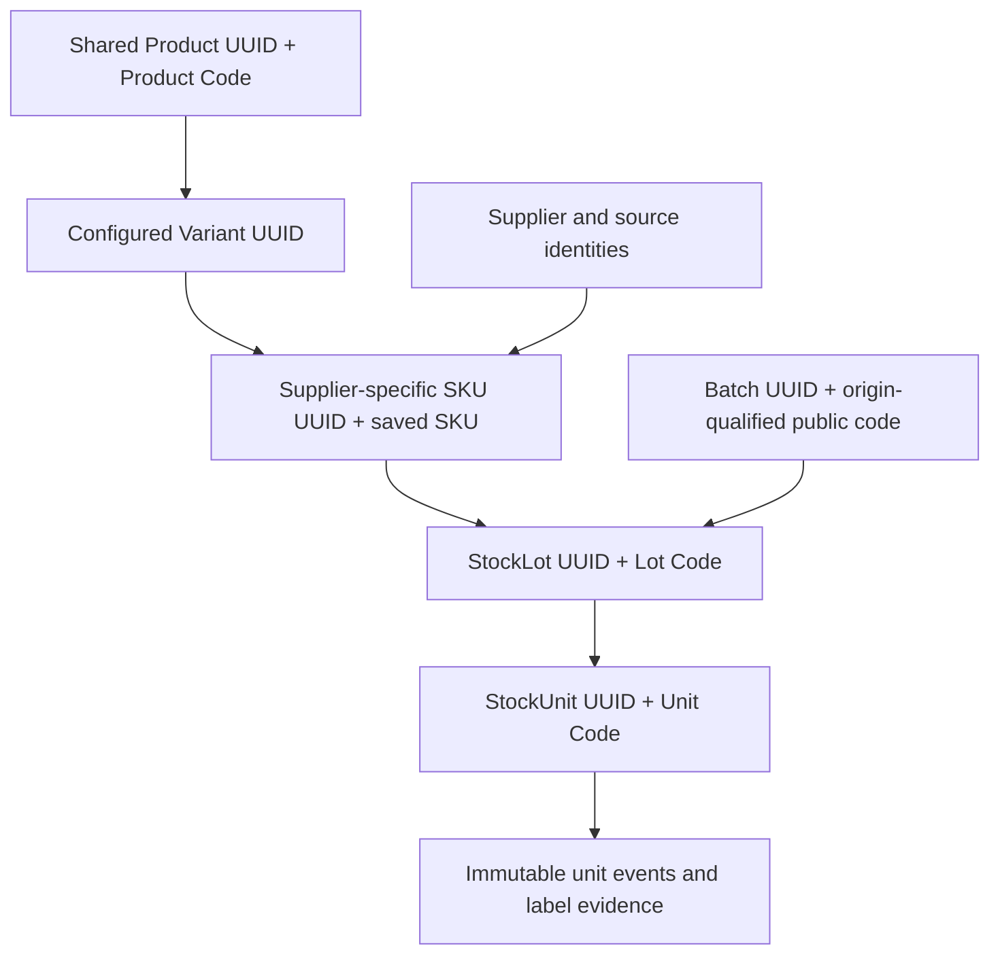
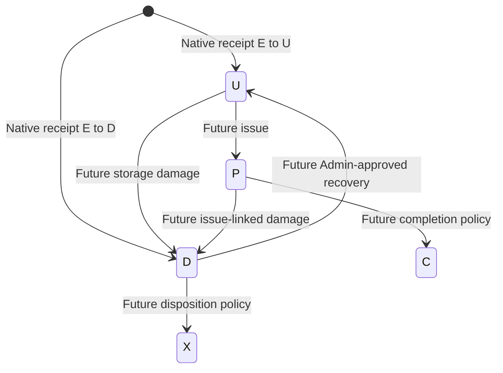

# Product identification, unit traceability, search and label UX

Phase 1 implemented; six-character Unit Code correction recorded 3 November 2026. Future unit implementation remains separately gated.

The owner correction supersedes all earlier U+7/eight-character unit proposals. See [six-character-unit-code-design.md](six-character-unit-code-design.md) for capacity, lookup, constraints, contracts and acceptance requirements. Product/Lot formats and DYI:1 are unchanged.

Historical clarification review below was documentation-only. The owner subsequently explicitly authorized Phase1 section17, including isolated migration/tests only; see phase-1-implementation-report.md. No operational migration/backfill/deployment or Phase2 continuation is authorized. CONFIRMED BASELINE means existing behavior; APPROVED DESIGN means the owner-approved direction or rule, not implemented functionality; PROVISIONAL means a benchmark/policy proposal still requiring evidence; OPEN identifies a remaining decision. Earlier PROPOSED wording is governed by the revised checklist in section 15. No application, Prisma, migration, stock-data, dependency or deployment change is authorized now.

## 1. Current architecture assessment and gaps

Read AGENTS.md, START_HERE.md, the complete root Dayari_Inventory_PRD_v1_2_Comprehensive.docx, implementation bricks, decisions, architecture, data-model, ledger-invariants, QR design and implementation report. Inspected schema, all migrations001–006, guards.sql, catalogue setup/service, receiving service, labels service/PDF renderer, shared contracts, web page/proxy, printing/scanning components and relevant test cases. The PRD is at root; the older docs/PRD path does not exist. Implementation addenda supersede earlier design-only paragraphs; historical proposals are not implemented functionality.

Actual stack: TypeScript monorepo, Next.js16.4.4/React19.2.4, NestJS12.3.2/Fastify, PostgreSQL/Prisma, Zod shared contracts, Tailwind4, a small shadcn-style Button primitive and lucide icons. A full shadcn component catalogue is not installed. Local qrcode1.5.4/PDFKit0.20.2 and Noto Sans render labels; native detection/ZXing browser0.2.1 scan them. Vitest, Supertest, Playwright and Docker Compose exist; native local PostgreSQL is also supported. The architecture remains a modular monolith. Production issues, recovery, closing, thermal integration and cloud synchronization transport are absent.

| Area | Actual implementation | Gap / consequence |
| --- | --- | --- |
| Product/variant | Product UUID/origin/name; Attribute/Value; immutable Variant and canonical VariantSelection | No shared Product Code. product-code.ts allocates supplier-product SKU bases, not the requested Product Code |
| Sourcing | SupplierSource → ProductSourcing → SupplierVariantSku; unique source/product and sourcing/variant; saved prefixes/base/SKU immutable | Shared parent aggregation must preserve distinct supplier SKUs |
| Extension | New combinations use all configured dimensions, source base reused; existing IDs untouched | Dynamic discovery needed. Allocated STD cannot silently become option product; unused empty default placeholder must not appear as phantom option |
| Receipt/lot | One source per batch, multiple products, exact SKU receipt lines; StockLot unique(skuId,batchId), ReceiptLine.lotId unique | No Lot Code, StockUnit or unit history |
| Ledger | Seven tables, E→U/D only, generated total, nonnegative balances, deferred completeness/provenance/evidence checks | Future transaction types remain disabled |
| Commands | OriginNode FOR UPDATE, active actor recheck, canonical hash, CommandResult scoped by origin/actor/type/key, atomic audit/outbox | Reuse this mechanism for new identities and metadata |
| Printing | Immutable LabelPrintJob/Line/Event; one initial per receipt; line unique(job,lot,purpose), quantity copies | Cannot represent exact unit selection/partial initial manifests without additive design |
| Lookup/UI | Strict DYI:1 lot QR; exact source/SKU/batch fallback; embedded PDF iframe/Open PDF to print | No short-code/name discovery, unit cart, React label preview, native HTML print or verification |
| Scaling | Catalogue and receiving options load bulk lists; stock endpoint unbounded; recent receipts/jobs capped100 | Do not reuse these as universal search or load every unit into browser memory |

Migration001 establishes catalogue/auth/origin/command/audit/outbox and guards;002 freezes supplier codes;003 adds registry/prefix;004 adds immutable receiving/ledger;005 adds lot print evidence;006 strengthens print provenance. guards.sql is a foundation helper, not another applied migration. Accepted StockLot/receipt/batch/movement updates/deletes and committed-batch supplementation are rejected. Adding a code column and UPDATE-backfilling StockLot would conflict with immutable guards: use sidecars.

Historical report:16 unit,34 integration and4 browser tests, typecheck/build passed. **Not rerun during Phase 0**; no serialization result is inferred. Physical printer/media/scanner acceptance remains open.

## 2. PRD amendments and preserved requirements

REQUESTED CHANGE: every newly received physical item gets a unique identity. Reopen O1/C03 and explicitly amend PRD §§1.2,3.1,12,14,15.1,15.4, which exclude V1 serialization/share lot QRs. Approve a dated PRD addendum before implementation; retain the original baseline. Update AGENTS invariant only after approval. Existing DYI:1 semantics never change.

Additional amendments: Product/Lot/Unit readable codes; operational server-side search; unit-level manifests/reprints; unit-label hierarchy replacing the primary lot-label presentation; native printing; optional attachment attestation; historical onboarding; explicit receiving resource limits. Future PRD §§5.2,10,15.5 bulk issuing must be revisited: quantity input cannot arbitrarily select serialized units. No issuing command or eligibility restriction is authorized here.

Preserve UUID authority, shared parent/variant identities, approved supplier/location prefix and random five-digit SKU-base rules, explicit suffix/STD rules, immutable accepted receipts, ledger authority/nonnegative stock, origin order, single shop stock writer, local LAN operation, audit/outbox/idempotency. Admin-only catalogue creation and existing receiving/printing role restrictions remain. No customer/orders/Sheets integration, new ledger workflow, thermal adapter or cloud transport.

## 3. Identity hierarchy and allocation proposal



Four requested code-bearing levels (product, SKU, lot, unit), with Variant a separate essential identity. Derive unit product/variant/source/batch through its lot/SKU; no independently editable duplicate relationships or code parsing.

PROPOSED alphabet: 23456789ABCDEFGHJKMNPQRSTUVWXYZ (31 characters, excludes0/1/I/L/O). Product/Lot type prefixes remain unchanged; L is a deliberate prefix exception, never a random body character. Unit Codes have no fixed U prefix: all six positions use the readable alphabet.

| Kind | Proposed format | Capacity per origin/kind |
| --- | --- | --- |
| Product | P +5 random characters, exactly6; P7K2M9 |31^5 =28,629,151 |
| Lot | L +5, proposed6; L8M4Q2 |28,629,151 |
| Unit | 6 random characters, exactly6; A7K2M9 |31^6 =887,503,681 |

APPROVED DESIGN A01 retains P+5/L+5/six-character Unit Codes with the retained alphabet; Unit length follows the owner's six-character correction. Product/Lot unprefixed alternatives remain rejected; the corrected Unit Code now uses six fully random characters. No checksum is included; valid typing mistakes can identify another record, so show identity confirmation.

Uniqueness is (originId,kind,code), not globally guaranteed bare code. UUID stays authoritative. Independent disconnected origins may allocate the same string. Current shop defaults to its origin; future federated reads return authorized exact matches with a shop chooser, carrying UUID context invisibly. Staff never type an origin UUID. Replication preserves code/UUID provenance rather than renumbering. Same-origin restored duplicate writers are a fencing/integrity failure, not an allocation collision. No automatic shared-product merging across origins.

Backend under origin command transaction: unbiased CSPRNG candidate → INSERT with database UNIQUE and ON CONFLICT DO NOTHING → repeat bounded32 attempts/identity → explicit allocation-busy error/full rollback. Do not catch a uniqueness error and continue an aborted transaction. No browser allocation, code recycling or hash-truncation guarantee. Retain immutable typed mappings even after retirement; monitor namespace occupancy and require a versioned decision before exhaustion/expansion. Idempotent replay returns the saved identity/code.

Collision illustration:10,000 independent draws into31^5 give about1.746 expected colliding pairs before uniqueness retries; into31^6 about0.05633. This is namespace arithmetic, not an accepted failure rate. Database constraints/retries prevent committed same-namespace duplicates.

## 4. Additive model proposal

This is a schema sketch, not a migration. UUIDs, RESTRICT FKs, server timestamptz, actor/command/origin evidence and immutable identity guards apply throughout.

| Table | Principal fields and constraints |
| --- | --- |
| ProductPublicIdentity | productId PK/FK, originId, code, policyVersion, commandId, assignedAt; UNIQUE(originId,code), origin matches Product, immutable/no reuse |
| LotPublicIdentity | lotId PK/FK, originId, code, policyVersion, commandId, assignedAt; same guards; no StockLot UPDATE |
| SerializationCutover | UUID, originId, policyVersion, activating command, recordedAt and committed watermark; immutable activation evidence |
| LotSerialization | lotId PK/FK, NATIVE/LEGACY policy and cutover reference; immutable sidecar. Coverage derived, not editable complete flag |
| StockUnit | UUID PK, lotId, originId, unitCode CHECK readable alphabet/exactly6, immutable initialCondition USABLE/DAMAGED, registrationKind RECEIPT/LEGACY_BASELINE, registrationCommandId, recordedAt; UNIQUE(originId,unitCode), UNIQUE(id,lotId). Receipt provenance derives via ReceiptLine.lotId |
| UnitEvent | UUID, unitId/lotId composite FK, per-unit ordinal, kind, from/to accounting states where applicable, actor/role/command, recordedAt and optional occurredAt, typed enrollmentId or movementId; UNIQUE(unitId,ordinal), append-only |
| UnitState | unitId PK, lotId composite FK, accountingState, condition, custody, version, lastEventId; rebuildable projection, no direct setter; no printing flags |
| UnitEnrollment | UUID, lot/origin, actor/command, cutoff sequence, captured balances, observed/assigned U/D counts, reason/evidence, recordedAt; immutable accepted baseline assignment |
| UnitCommandManifestPage | UUID, commandId/originId, page ordinal, exact bounded unit/event membership JSON, canonical hash/schemaVersion; UNIQUE(commandId,pageOrdinal), immutable. Membership must belong to the accepted command; deferred checks cover all pages |
| UnitLabelJob/Line/Event | Separate exact-unit print family, detailed below; immutable manifest/template/profile/renderer/hash, exact unit membership, typed original line links and attempts |
| UnitInitialLabelClaim | unitId unique PK/FK, initialLineId unique FK, origin; immutable initial-label reservation, never stock reservation |
| LabelVerificationSession/UnitLabelVerificationEvent | Exact job/line/unit context, actor/command, confirmation or invalidation/reason/time; duplicate-safe session/unit acceptance, append-only corrections |

Native initial UnitEvents link the exact E→U/D movement; their state/count matches its quantity. Baseline events link enrollment and have no stock movement. Composite provenance checks prevent foreign origin/lot/movement/manifest links. Creation-group guards reject adding receipt-born units after acceptance; baseline units require a separate accepted enrollment. Required command/audit/outbox evidence is checked at commit. Group count checks run once per affected lot/movement, not repeated full-lot scans per inserted unit. Future event kinds/typed issue or damage references are added only with those authorized domains. No speculative transition endpoint.

## 5. Lifecycle and exact reconciliation

Separate accounting lifecycle, physical condition, custody, printing and verification:

| Dimension | Proposed representation |
| --- | --- |
| Accounting | U usable on hand; D damaged on hand now. Future P in production, C completed/consumed, X removed |
| Condition | USABLE/DAMAGED; U requires usable, D damaged; initialCondition retained forever |
| Custody | SHOP_STORAGE now; future PRODUCTION/EXTERNAL with domain provenance, not an independent quantity |
| Label output | Claimed/prepared/handed off/operator-reported/unknown from print events |
| Attachment | Unverified/staff-confirmed/invalidated from verification evidence |

Received is an event, not another quantity bucket. Unprinted/unverified usable stock stays U. Intake warning is historical; after any future approved recovery current server condition must be shown separately. A sticker is never proof of current condition.



Only initial U/D and controlled baseline registration belong to the proposed serialization phase. Future arrows analyze PRD needs, not authorization. Completion/disposition/terminal conditions remain dependent on B03/B04/O8; no X→U assumption or automatic reversal.

At one committed watermark, for each lot L/internal state s:

```text
Q(L,s) = SUM(accepted movements into s) - SUM(out of s)
StockBalance(L,s) = Q(L,s) >= 0
N(L,s) = COUNT(registered units reconstructed in state s)
Native: N(L,U)=Q(L,U), N(L,D)=Q(L,D)
Native receipt count = usableQuantity + damagedQuantity
Initial usable/damaged unit counts = their exact receipt quantities
Initial event count linked to each movement = movement.quantity
Legacy residual R(L,s) = Q(L,s)-N(L,s) >= 0
Legacy: Q(L,s)=N(L,s)+R(L,s); complete coverage iff R(U)=R(D)=0
```

R is unassigned traceability coverage, derived from ledger and units, not extra inventory or independently editable balance. Current movements populate only U/D. Before future transitions, require the equation for every enabled state, exact movement/unit membership and per-issue/per-damage attribution. E has no physical projection/unit. C/X are accounted terminal units, not usable shelf stock.

Baseline assignment increases N/decreases R with deltaQ=0. Search/scan/print/verification/code assignment have deltaQ=deltaN=0. Future issue of k exact units must atomically commit k U→P unit events, one matching quantity transfer and both projections; future P→D damage leaves U unchanged. Native lots cannot accept ledger-only or unit-only transitions. Rebuild stock from movements and UnitState from events independently; compare, never repair mismatch by manufacturing a receipt. Physical counts remain independent evidence.

## 6. Atomic receiving and capacity proposal

Existing request bounds permit100 SKU lines and each U/D part up to2,147,483,647. Compact counts tolerate this; per-unit records do not. A04 classifies10,000 units/receipt,100 lines and500-row internal chunks as **PROVISIONAL**, not certified capacity. Do not lower existing receiving bounds during Phase 1. Phase 2 must benchmark and review the actual serialized limits before cutover. No background partial unit creation after stock acceptance.

Authenticate/validate limits → transaction → OriginNode FOR UPDATE → User FOR SHARE/recheck active role → idempotency/hash replay → active cutover/source/SKU validation → allocate batch/lots/Lot Codes → receipt/ledger/projections → all units/initial events/UnitState → grouped reconciliation → audit/outbox/CommandResult → deferred checks/commit. Server acceptance time after lock determines order and Africa/Lagos numbering; deliveredOn remains independent DATE. No network/rendering inside locks. Existing origin-first order is retained; affected lots and future unit rows lock in sorted UUID order. Bounded P2034/deadlock/serialization retries use the same command key, maximum2 retries; candidate collision retries are separate.

Bulk inserts in proposed500-row groups **inside the same transaction**; no commit per chunk, millions of JS objects or sequential one-unit Prisma round trips. Native serialization cannot fall back to quantity-only success. Response/CommandResult contains stable receipt, counts and paginated unit URL, not10,000 unit objects. Old replay responses remain byte/identity equivalent and do not gain retroactive units.

Outbox growth: propose versioned serialization summary/digest in the receipt envelope and immutable UnitCommandManifestPage records<=500 exact identities/events. The one receipt outbox acceptance references all page IDs/hashes; pages are durable in the same transaction with typed command links and completeness checks. Future transport stages dependencies then accepts the complete group atomically before acknowledgement, never partially visible stock. No transport implementation now. Page membership validation/size bounds belong to Phase2 constraints, not an unbounded JSON response.

Benchmark100/1,000/10,000 units, mixed lines and competing origin commands before activating limits. Proposed budgets: ordinary<=1,000 p95<=5s;10,000 transaction<=15s and end-to-end<=20s on agreed hardware. Existing15s DB/20s proxy timeouts leave little maximum-case margin; lower the cap or explicitly revise budgets after measurement, not silently extend forever. Targets are not measurements. Inject failures in every insertion chunk/audit/outbox stage: no batch number, unit, movement, balance, sequence or command fragment may remain.

Rough planning estimate: identity/state/initial event/indexes1–3KB/unit;1m units potentially1–3GB before print history, WAL and backups. Measure actual relation sizes/WAL/lock duration on rehearsal. Do not preemptively partition or introduce microservices; address unnecessary queries and per-unit trigger scans first.

### 6.1 Cutover enforcement and proof against old receiving writers

The following belongs to Phase2, not Phase1. Route consolidation alone cannot prove safety. Every newly inserted accepted batch/receipt after active origin cutover must satisfy database-required native serialization, including legacy endpoints or an old deployed ReceivingService binary. Deferred receipt-group checks must derive the requirement from the persisted origin cutover under the existing origin lock; an omitted LotSerialization row, missing unit events or client-supplied legacy flag must not exempt a new receipt. Assert complete unit counts, U/D membership, provenance and projections before commit. Existing accepted receipts are grandfathered by immutable pre-cutover evidence, never by a caller's delivery date or claimed software version. Activation serializes on the same origin lock as receiving, so an in-flight receipt commits entirely before activation or is checked entirely after it.

Mandatory proof matrix: current /v1/receipts, any retained compatibility route/helper, the pre-serialization service against the upgraded database, and direct runtime-role SQL all attempt quantity-only receipt acceptance after activation. Each must fail atomically without batch allocation/sequence/audit/outbox/command leftovers. Also test omitted policy rows, spoofed LEGACY marker, backdated deliveredOn, activation races, damaged-only receipt and unit-count mismatch. A native correctly serialized receipt must succeed. A historical same-key replay must return its original result without creating units; it is not a new receipt. Enumerate all receipt-writing entry points in the Phase2 report.

Runtime roles must lack DDL/trigger-disable/table-owner bypass privileges; migrate using a separate privileged role and fence old processes on rollout. Database guards reject stale writers even if process fencing fails. A database superuser can bypass controls and is outside runtime authorization; do not claim otherwise. Upgrade constraints through a new migration, never edits to001–006. Cutover is forbidden until the proof matrix passes. Phase1 does not activate cutover or certify this proof.

### 6.2 Provisional limits, benchmarks and legitimate oversized deliveries

Measure candidate100/1,000/10,000-unit deliveries and100-line mixed U/D cases using500-row and alternative chunk sizes on the intended shop configuration or explicitly identified representative hardware. Record database/app/OS versions, hardware, repeated runs/warm-up, p50/p95/max, end-to-end and transaction/lock-wait times, peak memory, WAL/disk growth, competing receiving/metadata traffic, retry rate, and complete rollback/recovery timings. Test exact bounds and over-bound validation, constrained disk/memory and failures between chunks. No capacity claim comes from a single passing fixture or an untested timing estimate. Provisional budgets above require measured headroom within DB/proxy timeouts, with reviewed cap/timeout changes rather than unlimited waits.

For a legitimate delivery exceeding validated limits, retain the operator draft and explain the limit before any acceptance. No automatic truncation, receipt splitting, acceptance followed by asynchronous units, or independent chunk commits. Present two review options: explicitly approved separate batches linked to the same factual delivery reference, accepting that those batches are independent transactions; or a separately designed staged-large-delivery workflow whose final acceptance remains atomic. Neither option is enabled or assumed approved here. Until an oversized-delivery policy and benchmark-backed cap are approved, escalation/review is required rather than silently bypassing serialization. Internal500-row chunks are an implementation batching parameter, not500 separately accepted receipts.

## 7. Historical stock onboarding and migration safety

**No real-data migration is approved.** New serialization begins at a server-controlled origin cutover, not factual deliveredOn. Backdated deliveries accepted after activation serialize; replaying old accepted commands does not.

1. Take coordinated encrypted backup of domain/command/origin/outbox/print data and prove isolated restore. Capture stock sums/projection hashes and all existing UUID/SKU/prefix identities. Unexpected future stock states or ledger mismatches stop migration.
2. Rehearse additive schema/indexes/constraints on restored fixtures. Never edit migrations001–006 or disable history triggers to backfill codes. New mappings record current assignment evidence; old receipt/label snapshots stay unchanged.
3. Only after approval allocate Product/Lot Codes via resumable bounded origin-locked metadata commands, proposed500 subjects each. Subject uniqueness reuses saved assignments after crash. Journal cursor/subjects/results. No Unit records or stock movement yet.
4. Deploy/fence old receiving writers, then activate cutover atomically. Native receipts require units. Legacy lots remain valid with explicit unassigned coverage and V1 lot-label notice.
5. Admin opens exact-lot onboarding; Manager may prepare observation under proposed permissions. Capture current lot balances/watermark; staff separately counts usable/damaged physical items. Show registered/unassigned/observed quantities. Do not mark a prefilled ledger total as physically counted.
6. Accept bounded baseline enrollment<=10,000 units under origin/actor/sorted lot locks. Recheck relevant lot watermark/balances, reject stale observation for review. Assigned U/D counts cannot exceed residual R. Create immutable units/codes/BASELINE_ASSIGNED events/current UnitState linked to enrollment and current recordedAt; no stock transaction, receipt movement or historical custody claim.
7. Physical discrepancy leaves explicit unresolved coverage/discrepancy. Excess/shortage never adjusts inventory through enrollment; separately approved count/correction workflow is required. Partial enrollment supports large legacy lots while each command is atomic and R stays visible. Complete coverage requires zero residual and no unresolved discrepancy.
8. New baseline identities are labelled and optionally attachment-verified separately. Registered quantity, observed enrollment and attached-label verification are distinct progress measures. Scanning a shared V1 QR must never pick one unit.

APPROVED DESIGN A05 retains Admin accepted enrollment and Manager prepared observations; real-data execution remains forbidden without separate approval. Incorrect baseline assignment is not editable/deletable/relinkable. Before real onboarding approve a separate invalidation/reconciliation policy; no ad hoc stock correction UI is part of this design. Native serialization can be approved separately from using onboarding on live stock.

Physical onboarding must separate already-serialized items from unassigned ones: scan existing labels first, use a counted/segregated tray for each accepted enrollment, attach or securely associate new codes before mixing stock again, and reconcile the remainder. Otherwise two operators can assign different codes to the same unlabelled item even though database counts balance. Serialize enrollment commands and require observation review; software cannot independently prove physical uniqueness. Missing/misattached old labels require controlled review, not silent new identity assignment.

Explicit discrepancy evidence: add proposed HistoricalCountObservation and HistoricalOnboardingDiscrepancy sidecars during Phase2 onboarding, not Phase1. Record lot/origin, actor/command, observedAt/recordedAt, captured stock watermark, expected ledger U/D, independently observed U/D and signed differences. Retain OPEN/ACKNOWLEDGED/RESOLVED history as append-only disposition events; no balance setter. A later resolution must link documented recount evidence or a separately authorized stock correction, never erase the observation or change Q to match it. Physical difference is not residual R: R measures unassigned identities even when physical counts agree. Display both independently. Partial enrollment, labels printed or R=0 cannot silently resolve a physical-count discrepancy. Historical registration events are recorded now as baseline assignments; do not fabricate receipt-time unit activity or attached-label verification.

Rollback before activation: old app may run while unused sidecars remain. After native receipts exist, old quantity-only writers are unsafe; stop writes/fix forward or use coordinated approved restore/replay reconciliation. Never drop unit evidence or lose accepted post-backup receipts to simplify rollback. Preserve old renderer/fonts/lockfile and print history. No automatic mass unit creation from original receipt totals, artificial opening receipt or automatic verified flag.

## 8. Versioned QR compatibility

APPROVED DESIGN A02 V2: DYI:2:<ORIGIN_UUID_32_UPPER_HEX>:<STOCK_UNIT_UUID_32_UPPER_HEX>,71 ASCII characters. V1 remains exact origin/StockLot. Parser returns LOT/version1 or UNIT/version2 discriminator; never reinterpret lotId. API/template/QR-symbol versions are independent. Keep legacy V1 response compatibility, with explicit new unit response contract.

Strict anchored uppercase grammar, supported bounded version, UUID validation and128-character request cap. Reject controls/lowercase/URLs/lookalikes/trailing text; input adapters remove only approved framing prefix/one CR/LF. Unknown/wrong-origin404 without cloud probe; malformed400; unsupported bounded version422. Persisted unit→lot→SKU→source/batch/origin joins decide resolution, not parsed short codes. Reprints preserve Unit Code and QR exactly. QR is neither secret nor proof of attachment/condition; copied stickers remain possible.

V1 UI: “Lot label — identifies delivery stock, not one physical item”, coverage and exact lot navigation. V2: Unit Code, parent/variant, saved SKU, Lot Code/batch, authorized current state and usable availability, local as-of. Zero usable resolves normally. Clear current availability on service failure; stale display cannot authorize stock actions. Offline means internet-independent local server/LAN, not phone writes after Wi-Fi/server loss. Existing camera secure-context/cleanup and HID framing rules remain.

## 9. Exact-unit printing and legacy evidence

Preserve all old LabelPrint* rows, constraints, V1 PDFs/profile/renderer hashes and original reprint endpoints. Never assign fabricated unit membership to old quantity lines. Show old jobs as **Legacy lot labels**. A06 approves exact-unit/native-print architecture. The narrower policy of blocking new legacy initial jobs for native lots while retaining historical inspection/explicit old-job reprint remains a proposal for Phase4 confirmation, not an unresolved approval of the overall A06 direction.

New UnitLabelJob family supports products/lots/receipts within **one origin and one compatible approved profile**. Each immutable line names one existing unit, one saved payload, content snapshot, ordinal and copies=1. Unique UnitInitialLabelClaim(unitId) prevents concurrent duplicate initials. Cart drafts claim nothing. Partial initial jobs are allowed; unselected units remain unclaimed. Abandoned claimed jobs remain resumable; do not erase claims to call another job initial.

Reprint names exact original unit-label line IDs with reason10..1000 characters; preserves QR/code/content/template/profile. Proposed one copy/unit/job; another deliberate reprint produces further copies/evidence, never another unit. Multiple originals with incompatible profile/template need separate reviewed jobs. Quantity-only requests cannot generate identities. “Add50” selects a materialized, reviewed set of50 different IDs, not50 copies of one QR.

Propose cart/job limit500 unique units. Server selection digest binds exact sorted membership/filter/watermark; at commit recheck eligibility and claims under sorted unit locks. Conflicts require revised review, never automatic substitute units. Initial/print-kind mixing is split visibly into separate jobs. Preflight layout outside locks, then origin/actor/key→membership/claims→immutable lines→audit/outbox/result→commit. Rendering/printing never writes stock or creates units.

Keep REQUESTED, ARTIFACT_READY, HANDOFF_REQUESTED, OPERATOR_REPORTED_PRINTED, FAILED, CANCELLED_BEFORE_HANDOFF, OUTCOME_UNKNOWN. Exact-unit output reports select printed unit/line IDs; unknown copy count must not mark arbitrary units printed. Prepared/handoff/reported/verified are independent counts. Reopening/refresh/afterprint/lost response never automatically prints. Preserve render concurrency2, stable retry keys, immutable hashes and explicit uncertainty.

### 9.1 Partial output, unknown results and duplicate stickers

For each attempt preserve exact manifest membership and distinguish confirmed printed subset, explicitly reported not printed subset, and unknown remainder. No report of a bare quantity assigns arbitrary unit identities. Operator-reported printed is neither attached nor verified. A jam after an uncertain point leaves affected IDs UNKNOWN until staff inspect; closing/reopening the browser or lost response cannot turn UNKNOWN into failed/no output or trigger automatic retry. Append follow-up evidence to the same attempt as appropriate; conflicting reports require explicit reconciliation rather than overwriting history.

Selective reprint requests identify existing original unit-label lines and a reason. Review shows units already reported printed/verified and unresolved attempts, asks staff to inspect prior output and select exactly which saved identities need another sticker, then creates a new reprint manifest. Reprint never creates a unit, changes its code/QR/lot, increments inventory or changes condition/verification. A replacement of a verified sticker may require explicit metadata invalidation/re-verification by Admin/Manager; no automatic invalidation from requesting a PDF.

Duplicate stickers for one unit carry the same identity and are physically possible even with perfect database uniqueness. Warn about duplicate risk before every reprint/another handoff. Staff must remove/destroy or segregate superseded/spoiled/excess stickers, ensure one intended item per code and record the reconciliation. Duplicate scans do not increase verification counts; suspicious repeats are warnings, not proof of another physical unit. Software cannot certify that unused copies were destroyed, prevent someone printing a downloaded PDF again, or detect the same code attached to two goods without staff inspection. No new stock or mandatory issue gate is invented as mitigation.

## 10. UX specification

### Discovery

Prominent **Find inventory** field: “Search product, SKU, lot or unit code”, focused scanner and camera controls. Debounce text250ms, abort old requests; exact code/QR immediately submits. Enter opens only a single exact authorized result; ambiguity requires choice. Broad queries show product summaries with code, matching variant chips and per-variant availability, not hundreds of units.

Progressive breadcrumb Product → Variant → Supplier SKU → Lot → Unit with shareable filter/navigation state. Product tabs **All registered variants** / **In stock** (usable>0). Facets come from configured attribute/value IDs represented in valid combinations, never hardcoded colours or only stocked SKUs. AND across dimensions, OR values within a dimension. Newly added Blue appears at0 in All, not In stock. Suppress unused empty default placeholders on option products; preserve real no-option STD behavior.

Variant view separates source SKUs; SKU view preserves lots/batches; lot view pages50 units with current state/label coverage. Aggregate only exact compatible product/variant/UOM. Current model has integer counted units and no UOM column: identify quantities as counted items, retain variant breakdown, no inferred piece/pack conversion or interchangeable Small/Large total. Future UOM policy needs separate design.

### Responsive print cart

```text
Labels & printing                    Find inventory [ notebook_____ ]
Inventory selection · two thirds     Print cart · one third, sticky
[Product / variant / supplier]       32 unique unit labels
[Lot L8M4Q2 · batch ...]              30 usable · 2 damaged intake
[Initial labels | Reprints]          Initial / explicit reprint group
[ ] A7K2M9 [View label]             Profile [70×35 A4 trial v2]
[ ] U8... Usable                     Expected sheets / warnings
[ ] U9... DAMAGED INTAKE              [Review & Print Labels]
[Add selected] [Add first50]          [Download PDF fallback]
```

>=1024px two columns;768–1023 stacked panels; below768 single column with sticky count/action and expandable cart.320px must not overflow;44px touch targets, focus rings, semantic labels and screen-reader statuses. Keep existing emerald/cream palette/Button conventions and consistent type/spacing, not an unrelated dashboard. Skeletons, empty states, explicit errors/retries and keyboard selection are required. Production has no inaccessible printing controls.

Inventory selection is paginated with explicit “first50”, not misleading all-pages checkbox. Cart deduplicates unit UUIDs, supports removal and confirmed clear. Preserve bounded cart IDs/profile/reason per actor/origin during Back/navigation; expire/clear on logout and revalidate on restore, never persist live stock authority. Initial/reprint groups have separate commands/reasons, visible before submission. Sheet totals use actual profile capacity and fresh-page artifact boundaries.

### Individual label preview

React LabelCard shows genuine SVG QR, bold Unit Code, product/variant, Lot Code, saved SKU/batch and damaged warning. Preview is individual content, not A4 geometry; page through/virtualize at most24 cards rather than500 QR DOMs. Caption explains actual size is controlled by profile. Use canonical payload with local encoder/assets, never decorative art or external services.

Propose unit-label-v2 template: QR left, Unit Code right, product/variant and Lot Code below, complete measured SKU/batch secondary. Keep existing70×35 and90×45 A4 trial geometries as candidates, no hardware certification. Never truncate essential code/QR/warning or shrink indefinitely. Wrap measured SKU/batch or reject smaller profile; descriptors may visibly abbreviate. Full UUIDs remain detail/manifest, not primary label text. Font coverage/quiet-zone/layout preflight precedes preparation. Reprints retain original snapshots; show live condition separately.

### Native printing and PDF fallback

1. Review & Print Labels validates selection/counts/damage/profile/reason and creates/replays immutable manifest. Prepare local layout/QR/font assets; no printer UI during preparation.
2. Ready review offers **Print Labels**. Fresh user click synchronously opens same-origin print-only window, making popup failure observable. Fetch exact authenticated prepared output, wait for fonts/SVG/layout readiness. If activation expires during async work, present a fresh **Open print dialog** button in the ready window.
3. Record idempotent HANDOFF_REQUESTED before calling window.print(). Evidence failure prevents invocation; popup/dialog/network blocks offer explicit retry. Do not require PDF download or embedded PDF viewer.
4. Print document uses versioned @page A4/mm, fixed cells, zero document margins, no split labels, explicit breaks, local fonts/black SVG; navigation/cart absent. Browser headers/scaling/driver margins remain operator/physical acceptance responsibilities.
5. Return to operator outcome reporting: exact units printed, failure or uncertain. Synchronous busy latch/stable attempt key prevents double-click/network replay; repeated handoff warns about prior output. No automatic printing on retry. print() return or afterprint never certifies printing/cancellation.

Store PRINT_HTML representation hash/assets/template/fonts/renderer and ordered manifest/layout digest. Optional deterministic PDF has a **different binary hash** but same exact membership/layout plan. Browser/driver output is not byte-deterministic or a known spool artifact; never claim PDF hash certifies HTML output. Retain frozen HTML/local assets or pinned reconstruction capability; old renderer remains available. No silent/thermal/device API.

Browser limitations verified against [MDN print](https://developer.mozilla.org/en-US/docs/Web/API/Window/print) and [afterprint](https://developer.mozilla.org/en-US/docs/Web/API/Window/afterprint_event). Lifecycle observations cannot replace explicit operator outcomes.

## 11. Optional attachment verification

APPROVED DESIGN A07: Admin/Manager opens a job-scoped session with intended product/variant/lot and exact membership; attaches label, scans V2 or enters Unit Code, reviews expected physical item and explicitly confirms attachment. Scan alone remains a read. Submission appends idempotent evidence. Wrong manifest/origin/unit and V1 shared labels reject. Duplicate scan says Already verified, counts no extra unit. Progress18/30 counts distinct currently confirmed unit identities, not attempts; repeated sessions do not inflate global coverage.

Confirmation and explicit reasoned invalidation are append-only; current verified status is a projection. Invalidation allows explicit re-verification without erasing history. Confirmation does not depend on trusting operator print counts (unknown-output labels may exist), but requires exact manifest membership and physical item review. It is staff attestation, not conclusive proof of attachment/authenticity. No quantity/condition/custody change. Approved Admin/Manager only; Production read-only. No verification-before-issue restriction is approved.

## 12. API contracts and security proposal

All routes below are **proposed**, using existing /v1 Nest/Fastify and same-origin Next proxy conventions. Add explicit proxy route allowlist entries during implementation, never wildcard forwarding. Existing V1/legacy routes stay compatible.

The current proxy supports JSON and binary PDF, not authenticated HTML print documents. The printing slice must explicitly add no-store HTML/SVG asset handling on a same-origin print route with restrictive CSP, locally bundled fonts and escaped trusted manifest text. Do not send session tokens in window URLs or allow arbitrary submitted HTML. Window navigation uses the existing same-origin session; server-side forwarding retains authentication and field checks.

Common validation: strict Zod objects; max query120 characters/10 tokens; page default20/max50; opaque signed cursor bound to origin/role/query/filter/sort; UUID validation; decimal-string counts. Manual short-code input trims/ASCII uppercases but does not replace ambiguous characters; QR remains strict canonical bytes. All read DTOs have local dataAsOf/origin watermark and no write effects. Metadata mutations require UUID Idempotency-Key, canonical hash, role recheck, origin locking, audit/outbox/result transaction. Same key/body replays; different body409. Legacy old response replay remains intact.

| Route | Contract / purpose |
| --- | --- |
| GET /inventory/search | q/scope/origin/cursor/limit → typed exactMatches, product summaries, nextCursor, dataAsOf/watermark; ambiguity chooser, no arbitrary first |
| GET /inventory/products/by-code/:code | Exact origin-scoped Product Code → ProductSummary; no fuzzy fallback |
| GET /inventory/products/:id | ProductSummary with code/name/configured dimensions, child links and compatible per-variant counted-item availability; no unit dump |
| GET /inventory/products/:id/variants | view=all/in-stock, attribute/value ID filters/cursor → VariantSummary and usable totals by exact variant |
| GET /inventory/products/:id/facets | Valid configured dimensions/values and optional contextual counts; immediately reflects catalogue extension |
| GET /inventory/variants/:id/skus | Paged sourcing identity/source display/saved SKU and permitted quantities |
| GET /inventory/skus/:id/lots | Exact supplier SKU lots, Lot Codes, origin-qualified batches and permitted balances |
| GET /inventory/lots/by-code/:code; GET /inventory/lots/:id | Exact lot/provenance/coverage/current quantities/child links |
| GET /inventory/lots/:id/units | Paged<=50 UnitSummary, state/label filters, no invoice/audit details |
| GET /inventory/units/by-code/:code; GET /inventory/units/:id | Exact UnitSummary; usable boolean is distinct from lot usable quantity |
| GET /inventory/units/:id/events | Admin/Manager bounded operational trace history only; Production denied; no unrestricted audit object |
| POST /qr/resolve | Existing read endpoint dispatches V1 LOT/V2 UNIT; no key/write effect; strict parser and role DTO |
| POST /unit-label-plans | Admin/Manager read-only selection validation, <=500 IDs or one bounded selector/count → exact paged IDs/digest/counts/eligibility/profile/sheets; no command/key |
| POST /unit-label-jobs | INITIAL: unitIds/profileId/selectionDigest; REPRINT: originalLineIds/reason. Admin/Manager idempotent metadata; one copy/exact unit; compatible original profiles required |
| GET /unit-label-jobs; GET /unit-label-jobs/:id | Paged summaries/header and paged lines/events, Admin/Manager only |
| POST /unit-label-jobs/:id/artifacts | PRINT_HTML or PDF/part → artifactId/digest/URL; render outside locks, idempotent metadata; authenticated GET print-document/PDF retrieves prepared output |
| POST /unit-label-jobs/:id/events | attemptId/kind/artifactId and exact reported printed line IDs; no stock effect |
| POST /label-verification-sessions | Admin/Manager proposed; exact job, key → session/progress |
| POST /label-verification-sessions/:id/confirmations | Exact payload/unitId/lineId plus explicit attachment confirmation; key; duplicate-safe metadata |
| POST /unit-label-verifications/:id/invalidations | Admin/Manager proposed; reason/key; append correction, no stock |
| POST /unit-enrollments | Admin proposed; legacy lot/watermark/observed assignment counts/reason/key; bounded baseline unit creation, delta stock0; real-data use separately gated |

Example UnitSummary (placeholders illustrate fields, not literal accepted UUIDs):

```json
{"kind":"UNIT","payloadVersion":2,"unitId":"<UUID>","unitCode":"A7K2M9",
 "productId":"<UUID>","productCode":"P7K2M9","productName":"A5 Maple Leatherbound Notebook",
 "variantId":"<UUID>","attributes":[{"attributeId":"<UUID>","valueId":"<UUID>","label":"Red"}],
 "fullSku":"CHILG03849-RED","lotId":"<UUID>","lotCode":"L8M4Q2",
 "batch":{"originId":"<UUID>","publicCode":"B-20261103-0001"},
 "availableUsable":true,"lotUsableQuantity":"30","dataAsOf":"<server timestamp>"}
```

ProductSummary: productId/productCode/name, typed matching variant summaries and child links. VariantSummary: variantId, configured selected value IDs/labels, usable string, supplier count. LotSummary: lotId/lotCode, SKU, qualified batch, usable string, permitted damaged/coverage fields. No generic ORM include response. Page responses have items/nextCursor/dataAsOf/originSequence. Admin/Manager trace fields expose operational event type/time/reason/source links, not unrestricted audit or actor credentials.

| Capability | Admin | Manager | Production |
| --- | --- | --- | --- |
| Catalogue creation/extension | Existing allowed | Denied | Denied |
| Receive serialized stock | Existing allowed | Existing allowed | Denied |
| Product/variant/SKU/lot/unit usable discovery | Allowed | Allowed | Approved operational-only read |
| Supplier/source display names | Allowed | Allowed | Approved nonsensitive operational labels only |
| Damaged totals / detailed unit trace | Allowed | Allowed operational scope | Denied; exact unit usable yes/no only |
| Invoice/valuation/unrestricted audit via search | Not exposed here | Not exposed | Denied |
| Print plans/jobs/artifacts/outcomes | Allowed | Allowed | Denied |
| Legacy enrollment acceptance | Approved design; real-data execution separately gated | Observation draft only | Denied |
| Attachment confirmation/invalidation | Approved design | Approved design | Read-only status where needed |

A03/A05/A07 approve these permission designs; they do not authorize implementation or real-data enrollment. Production supplier/source exposure is limited to operational display names/identity context, never contacts, addresses, bank/payment/contract details, costs, invoice data, damage history/totals, unrestricted audit or print administration. Enforce explicit DTO allowlists and negative tests, including facets/counts and directly addressed records. Filter authorization applies to direct ID routes, counts/facets and row scope as well as UI. Missing/foreign IDs consistently404. Use active server session/CSRF/same-origin cookies; private no-store output; no credentials/private data in QR. Parameterized SQL/escaped LIKE, names rendered as text, no uploaded script/HTML/SVG. No CDN or cloud dependency.

Errors:400 INVALID_INPUT/INVALID_QR/INVALID_CURSOR;401 invalid session;403 ROLE_DENIED;404 IDENTITY_NOT_AVAILABLE;409 IDEMPOTENCY_CONFLICT/INITIAL_LABEL_ALREADY_CLAIMED/STALE_SELECTION/STALE_ENROLLMENT/CODE_ALLOCATION_BUSY;422 UNSUPPORTED_QR_VERSION/LABEL_PROFILE_INCOMPATIBLE/SERIALIZATION_LIMIT_EXCEEDED;429 RATE_LIMITED;503 SHOP_UNAVAILABLE. Ambiguous exact search returns200 choices; integrity failure alerts without invented quantities. Proposed search60 requests/min/actor, exact QR/unit reads120/min, render concurrency2; Retry-After on throttle. Existing process-local throttle assumes one process; revisit if deployment scales.

## 13. Search execution and performance

Exact B-tree lookup first for applicable Product/Lot/Unit code namespaces, saved full SKU and readable origin-qualified batch. Code-shaped legacy SKU can collide with a new code: return typed exact choices, never guess. Batch returns its multiple lots. A missing code shows Code not found with explicit optional name-search action, not silent fuzzy substitution.

Text tokens match within the **same valid variant/sourcing context**. Red notebook matches product notebook and a real Red variant; do not join Red from one combination to Large from another. Supplier tokens constrain real sourcing. Catalogue-first LEFT JOIN stock retains zero-stock variants. Rank exact phrase then prefix/token with stable UUID tie-break; no automatic product merge or inferred synonyms.

Recommend PostgreSQL simple-config full-text and pg_trgm GIN for infix names, no external search service. Rebuildable per-variant/sourcing documents hold product/variant/value/supplier/source text, maintained with catalogue commands. Exact identities keep B-trees; [PostgreSQL17 pg_trgm](https://www.postgresql.org/docs/17/pgtrgm.html) documents indexed text matching. Check extension availability during rehearsal; none installed now. Accent aliases/synonyms deferred.

Indexes: typed origin/code unique keys; StockUnit(lotId,id); UnitState(lotId,state,unitId); SKU(productId,variantId); sourcing(sourceId,productId); lot(skuId,batchId); event(unitId,ordinal). Reuse existing indexes, avoid duplicates. Limit candidate products before child summaries; SQL aggregates/EXISTS and a fixed small query batch avoid N+1. Never calculate availability from unit rows or silently aggregate incompatible variants.

One response uses Repeatable Read; later pages are current reads, not a held database snapshot. Cursor binds filters/sort, but changed catalogue/availability may require refresh; no frozen-stock promise. Text minimum2 characters, exact identifiers independent; debounce250ms. Proposed benchmark10k products/100k lots/1m units: exact p95<=300ms/text first page<=750ms on agreed LAN/hardware; measure query plans/counts and memory. These budgets await validation.

## 14. Acceptance plan — not executed

| ID | Required evidence after implementation approval |
| --- | --- |
| UT01 | Code lengths/alphabet, forced collisions/retry exhaustion/DB uniqueness/no reuse, immutability; independent origins same bare code coexist/ambiguity, no renumbering |
| UT02 | Product/Lot backfill crash/resume; all old UUID/SKU/prefix/receipt snapshot/CommandResult/PDF hashes unchanged |
| UT03 | New Blue extension visible at0 in All/facets, excluded In stock; multi-attribute combinations, STD guard, supplier sharing/multiple batches |
| UT04 | Exact code/SKU/batch precedence, partial notebook/Red notebook/source search, ambiguous cross-kind identity, pagination/query/rate limits and role-safe counts |
| UT05 |30 U+2 D creates32 distinct unit codes/QRs/events; multi-product62 U+3 D gives65 units/3 lots; another supplier/delivery stays independent |
| UT06 | Same-key/concurrent/lost-response receipt replay one identity set, different hash409, intentional new keys; backdated delivery cannot change cutover/order |
| UT07 | Failure every bulk chunk/collision/audit/outbox/command/deferred check rolls back units, stock, batch allocation and origin order; deadlock retry no duplicates |
| UT08 | DB rejects foreign origin/lot/movement, orphan events, late receipt units, mismatched U/D counts, negative Q/R, state/history tampering, duplicate codes; full section6.1 old-writer/direct-SQL/omitted-policy/backdated/cutover-race proof; no unenabled transition |
| UT09 | Legacy initially unassigned, partial enrollment/residual equations, stale/replay/overassignment rejection; persisted unresolved physical discrepancy distinct from residual and never stock update; no invented historical event/verified flag |
| UT10 | Existing V1 lot resolution/reprint/PDF unchanged; V2 exact unit; malformed/unsupported/wrong-origin/unknown/zero usable; no arbitrary unit or stock deduction |
| UT11 | Cart dedup/removal/Back/discard/restored draft, concurrent initial claims, exact membership/one copy, explicit reprint identity/content stability, profile mismatch/500 cap |
| UT12 | Genuine React SVG; independently decode every distinct unit QR from final HTML-print raster and PDF300DPI; quiet zones/font fit/geometry/no clipping/damaged warnings |
| UT13 | Popup/readiness/user activation/native print DOM/CSS; lost response keeps attempt; before/afterprint never success; exact printed/not-printed/unknown subsets, duplicate-sticker warning/selective saved-unit reprint; PDF fallback |
| UT14 | Verification confirmation/membership/duplicate scans/sessions/invalidation; counts distinct units; no condition or quantity changes |
| UT15 | Direct API all-role/disabled-user/foreign-origin tests; Production never invoice/damage totals/print/audit/admin fields; filters/counts cannot bypass scope |
| UT16 | Snapshot all7 stock tables and receiving CommandResults before/after search/scan/cart/printing/verification, byte-equivalent. Metadata may advance general origin order. Enrollment changes units but not ledger |
| UT17 |100/1k/10k receiving and500 selections, large search fixtures; measured lock/memory/WAL/query plans/duration; chunks never commit partial receipt |
| UT18 | Full unit/PostgreSQL-Supertest/browser/catalogue/extension/receiving/ledger/QR/print regressions, root typecheck/build; no weakened tests |
| UT19 | Legacy-to-additive migration rehearsal, old/new identities and both print systems; restore/cutover fencing/fix-forward; production migration separate approval |
| UT20 | Actual A4 printer/media/scanner/phone HTTPS/adhesion/working distance/orientation,100% sizing, internet-loss local operation, copied/wrong attachment SOP; named owner physical acceptance |

Preserve the existing65-copy lot-label test expecting3 identities; add a distinct unit-label test expecting65, rather than rewriting history's expected result. Browser automation can spy on print()/print media or inspect native print document; it cannot certify OS spool output. Screenshots320/390/768/1440, keyboard/screen-reader/focus and actual supported browser print trials are required later. Record hardware/settings/results; no physical readiness claim from digital QR decoding.

## 15. Risks and owner approval checklist

Main risks: single-origin lock contention/storage growth, dual ledger/unit drift, fabricated historical attribution, old writer bypass, short-code namespace confusion, duplicate physical stickers, browser geometry variance and Production data exposure. Controls above require implementation proof. Retention/RPO/RTO and future issue/completion/disposition rules remain open. No stock-correction/closing restriction is silently added.

Owner clarification outcome (this review): architectural direction accepted; approvals below concern design, not implementation. This checklist supersedes the original unchecked proposals without implying tests or migrations occurred.

- [x] **A01 APPROVED DESIGN:** retain P+5, L+5 and six-character Unit Codes; origin-qualified identities/lookups, database collision protection, documented capacity, immutable codes/no renumbering across independent shops. Section3 governs the namespace.
- [x] **A02 APPROVED DESIGN / PROOF REQUIRED:** immutable mappings, serialized receiving and DYI:2 units beside unchanged DYI:1 lots. Section6.1 defines mandatory database enforcement and old-writer bypass tests before cutover.
- [x] **A03 APPROVED DESIGN:** role-specific search DTOs; Production only operational identities/nonsensitive source labels/usable availability, no sensitive supplier, invoice, damage history/totals, audit or print-administration data. Full search remains Phase3.
- [ ] **A04 PROVISIONAL / BENCHMARK GATE:**10,000 units,100 lines and500-row chunks are candidate operational settings, not verified limits or throughput promises. Section6.2 covers workload/recovery evidence and oversized legitimate deliveries before activation.
- [x] **A05 APPROVED DESIGN ONLY:** controlled historical onboarding with authoritative ledger unchanged, explicitly persisted unresolved count discrepancies, no fabricated historical unit events/verification. **Real-data execution is not approved.** Invalid baseline resolution policy remains a later onboarding gate.
- [x] **A06 APPROVED DESIGN:** exact-unit manifests, native print/PDF fallback, partial/unknown outcomes and selective reprints of saved identities; printing never creates units. Duplicate physical stickers remain an operational risk requiring section9.1 controls. Numerical cart caps and legacy-initial restriction remain engineering proposals to confirm in Phase4 review.
- [x] **A07 APPROVED DESIGN:** optional Admin/Manager verification/invalidation, no stock effects and no mandatory Production issue gate.
- [x] **A08 APPROVED DESIGN:** checkout cart with individual product-label React previews as primary frontend; no A4 pages/PDF viewers/paper-sheet mockups as the primary preview. Physical profiles/print-only output remain separate; hardware acceptance still outstanding.
- [x] **A09 PHASE1 AUTHORIZED:** owner explicitly authorized section17 on3 November2026. Only human-readable Product/Lot identity slice and isolated development/test migrations/rehearsals. Real-data migration/backfill/deployment and all later phases remain gated.

## 16. Proposed implementation sequence

1. **Phase1 — Human identities:** finalized scope in section17, awaiting explicit implementation authorization. Product/Lot codes only; no StockUnit, serialized receiving activation or print redesign. Report and stop; real-data backfill separate.
2. **Phase2 — Units:** approved event/state/coverage schema, atomic receiving/limits/cutover, onboarding and reconciliation/performance/failure tests. Native serialization and real onboarding approval may be separated. Report/stop.
3. **Phase3 — QR/search:** V2 with V1 compatibility, code/manual search, dynamic facets and role-safe product→variant→SKU→lot→unit navigation. No issue command. Report/stop.
4. **Phase4 — Print UX:** exact-unit evidence/claims, versioned HTML/PDF renderers, genuine React previews, responsive cart/native print/uncertainty; preserve legacy regression. Stop for physical trials.
5. **Phase5 — Verification:** approved role/policy, explicit attachment sessions/progress/invalidation and stock isolation. No issue restriction. Report/stop.
6. **Phase6 — Final checks:** complete automated/security/load/restore regressions, actual hardware trial evidence and owner review before deployment. Future inventory workflows remain excluded.

Each separately authorized implementation phase is a vertical slice (schema/service/API/contracts/tests/UI), not a license to implement later phases automatically. No production deployment/data migration inferred.

## 17. Finalized Phase 1 scope — explicitly authorized for isolated implementation

**Objective:** add human-readable shared Product Codes and exact StockLot Codes as immutable alternate identities. Phase1 does not implement Unit Codes/StockUnit, activate serialization, change receiving quantity limits, introduce universal text search or redesign labels/printing.

**Deliverables after authorization:**

1. Add only ProductPublicIdentity and LotPublicIdentity sidecar models via a new additive migration with typed FKs, origin-match enforcement, unique origin/code and subject keys, code grammar and immutable/no-reuse guards. Retain all existing UUIDs/SKUs/prefixes/receipt snapshots/print evidence; do not add mutable code columns to immutable stock records. Record a dated documentation addendum for the approved identity direction without rewriting the original PRD binary.
2. Backend P+5/L+5 allocator using the31-character alphabet in section3, unbiased randomness, collision-safe insert/retry, finite capacity/no silent expansion. Use existing command/origin/audit/outbox/idempotency patterns. Allocate P when a new shared parent is accepted through **every** existing product-create/setup path; reusing/extending a parent never allocates another P. Allocate L for each new lot through existing receipt acceptance, atomically with that receipt. This is identity metadata integration, not unit serialization or a change to stock accounting. Old accepted command replays do not receive retroactively changed responses.
3. Enforce required mapping presence for newly created subjects at the database boundary, scoped to the migration's activation policy so historical unmapped records stay valid. Stale creation paths must roll back rather than leave new products/lots without codes. Do not weaken accepted-batch history guards. No assertion that these Phase1 guards prove later unit serialization: section6.1 proof belongs to Phase2.
4. Exact Product/Lot code lookup with explicit origin context/default current shop, consistent role DTOs and typed ambiguity handling. Add a bounded authenticated code-entry/identity-display surface to current catalogue/stock/QR lookup contexts: Admin/Manager see new codes, Production only approved minimal operational identity/usable fields. Existing catalogue-write/receiving/print permissions stay unchanged. No bulk catalogue refresh used as new search engine, no full unit hierarchy or supplier administration expansion. Full fuzzy/text search and new dynamic inventory pages remain Phase3.
5. Implement an explicit, resumable, dry-run-first mapping-backfill tool with progress, subject/origin filters, bounded transaction batches and immutable audit/command evidence. Exercise **only synthetic/restored isolated test fixtures** for existing products/lots; zero unit enrollment/stock movement. No automatic application-startup or migration-time operational backfill. Real/dev operational stock mapping execution needs separate owner approval; old unmapped identities remain readable by UUID/SKU/batch and show Code not assigned. Dry-run must report allocations needed, not reserve/recycle accepted codes.
6. Unit/integration tests for format/alphabet/candidate collisions/exhaustion, concurrency/idempotency/replay, immutable mappings, wrong origin/cross-origin identical code with no renumbering, all creation paths, failed mapping rollback, and restartable backfill. Compare all existing stock rows, old CommandResults/QR/PDF identity evidence before/after mapping-only operations. New accepted receipts may create their normal ledger records, with no additional movement due to code assignment. Run existing catalogue/extension/receiving/QR/print regressions, browser code-entry/display checks, typecheck and build; report actual commands/results.
7. Deliver Phase1 implementation report with changed files/new migration/API examples/UI evidence, preservation checks, tests and remaining gates; stop. No production-data execution/deployment or Phase2 continuation.

**Planned exact lookup contract:** GET /v1/inventory/products/by-code/:code and /v1/inventory/lots/by-code/:code, optional validated originId. Default is current shop; explicit unavailable origin404 in current local deployment. Future authorized federated search must return multiple origin-qualified exact matches rather than choose/renumber one. A cross-origin picker is only shown when multiple origins are actually available, not a claim that synchronization now exists. Read DTOs expose Product/Lot Code, corresponding UUID, permitted product/variant/SKU/batch identity, usable availability and dataAsOf only; Admin/Manager operational fields remain explicitly allowlisted. No invoice/audit/print data. Metadata lookup is read-only/no idempotency write; mapping writes reuse existing command keys. Product Code allocation never calls or changes the existing supplier-base allocator named product-code.ts.

**No unresolved architectural conflict blocks this bounded Phase1 design.** Phase1 implementation authorization was subsequently received; completion evidence is in phase-1-implementation-report.md. Later-phase gates: measured receiving caps/oversized-delivery policy, invalid baseline assignment resolution, physical printer/media/HTTPS trials and retention/recovery procedures. Original PRD batch-only wording requires the documented serialization addendum before Phase2 activation; V1 lot behavior remains correct during Phase1. Approval of architectural direction does not imply later hardware/performance proof, real-data migration or deployment.

## Documentation revision verification

This owner-clarification revision changes only this design, decisions, traceability and implementation-brick documentation. UTF-8, code fences, local link targets, all17 numbered sections and9 approval entries passed documentation checks. Before/after SHA256 fingerprints for application/shared-contract source, schema, all SQL migrations and package manifests/lockfile matched. No database operation/deployment occurred. No application test/benchmark or cutover proof is claimed to have run during this revision.

## Phase 0 execution record (original delivery)

Created this document; appended proposed review status to decisions, requirements traceability and implementation bricks. No application/dependency/schema/migration/database changes. Inspection used file reads/inventory, DOCX XML extraction, migration/test-source review, Python namespace arithmetic and primary browser/PostgreSQL documentation. Initial Windows console encoding failure during PRD extraction was corrected with UTF-8 and the rest read. One oversized document-write command failed before execution (Windows command-length limit); the document was created through the patch tool instead. Documentation validation passed for all four files: valid UTF-8, balanced fenced blocks, existing local link targets, all9 approval points and20 planned test groups present. No application tests, benchmarks, PDF rendering or physical checks were executed in Phase0. Prior reported passes remain historical.

Constraint reference: [PostgreSQL17 constraints](https://www.postgresql.org/docs/17/ddl-constraints.html). Cross-row reconciliation needs FKs/deferred checks/transactions, not a row CHECK reading another table.
